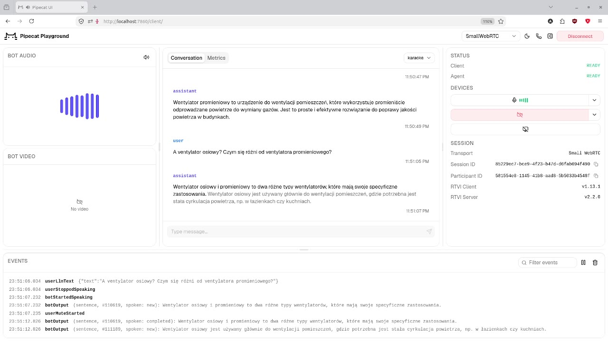

# Poziomka dostaje głos

[](demo/poziomka_glos_demo.mp4)

*Demo (94 s, kliknij miniaturę): rozmowa z Poziomką w przeglądarce, wszystko na jednej RTX 5080.*

Polski asystent głosowy na własnym GPU: Silero VAD v6 → Canary-1b-v2 (STT) → Poziomka-Instruct (SGLang, FP8) → VoxCPM2 (TTS), połączone przez [Pipecat](https://github.com/pipecat-ai/pipecat). Całość mieści się na jednej karcie 16 GB.

```
bash uruchom.sh      # LLM -> TTS -> STT -> bot, potem http://localhost:7860/client
bash zatrzymaj.sh
```

Środowiska (`uv venv`): `.venv-llm` (sglang 0.5.22), `.venv-tts` (voxcpm), `.venv-stt` (transformers, Canary), `.venv-bot` (pipecat-ai 1.14.0), `.venv-quant` (llm-compressor, do `kwantyzuj_fp8.py`). Decyzje, pomiary i znane problemy: [PLAN.md](PLAN.md).
